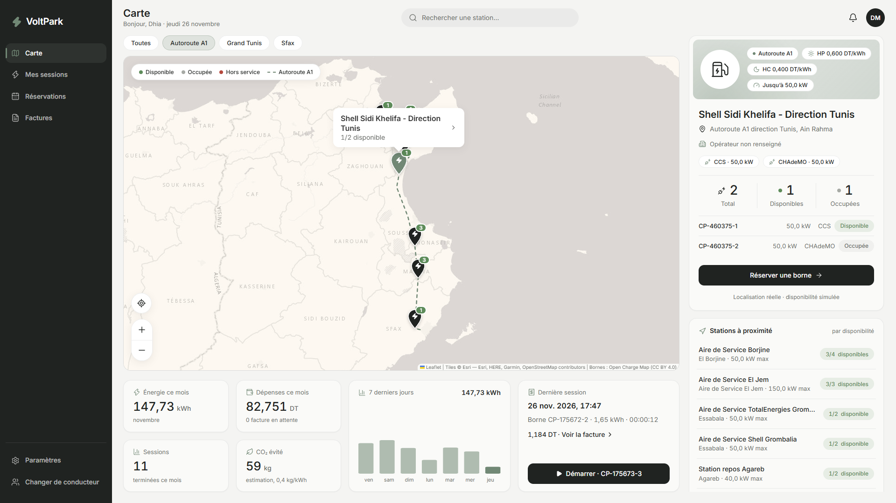

# VoltPark

[](https://github.com/dhiamliki/voltpark/actions/workflows/ci.yml)

VoltPark est une plateforme de gestion d'un réseau de bornes de recharge pour véhicules électriques.
Les conducteurs recherchent une station, réservent une borne, démarrent et arrêtent une session de charge, puis reçoivent une facture.
Une partie du parc est composée d'anciennes bornes qui ne parlent qu'un protocole SOAP historique (inspiré d'OCPP 1.5) : une passerelle dédiée fait le lien avec ces bornes.
Les mesures d'énergie remontées par les bornes sont collectées en continu via gRPC afin de suivre les sessions en temps réel et de calculer le montant facturé.

## Architecture

| Service | Style | Port | Base de données |
|---|---|---|---|
| `api-gateway` | Spring Cloud Gateway | 8080 | aucune |
| `session-service` | REST `/api/v1` | 8081 | PostgreSQL `session-db` |
| `charger-gateway-service` | SOAP (contract-first) | 8082 | PostgreSQL `charger-db` |
| `energy-service` | gRPC | 8083 (HTTP/actuator), 9090 (gRPC) | PostgreSQL `energy-db` |
| `charger-simulator` | client gRPC | - | aucune |
| `frontend` | React + Vite + TypeScript (nginx) | 3000 | aucune |

Chaque service possède sa propre base de données. Les services se trouvent entre eux par le DNS de Docker Compose (réseau `voltpark-net`).

```
                     HTTP                    HTTP
  +----------+   /api/v1/**   +-------------+        +-----------------+
  | frontend | -------------> | api-gateway | -----> | session-service |
  +----------+                +-------------+        +-----------------+
                                                       |      |      ^
                       SOAP (WebServiceTemplate)       |      |      | gRPC server streaming
                 +-------------------------------------+      |      | WatchSession
                 v                                            |      | (expose par session-service)
  +-------------------------+          gRPC unary             |      |
  | charger-gateway-service |          GetSessionEnergy       v      |
  +-------------------------+                             +----------------+
                                                          | energy-service |
                                                          +----------------+
                                                                  ^
  +-------------------+   gRPC client streaming                   |
  | charger-simulator | ------------------------------------------+
  +-------------------+   StreamMeterValues
```

Flux :
- Frontend -> api-gateway -> session-service
- session-service -> charger-gateway-service (SOAP, `WebServiceTemplate`)
- session-service -> energy-service (gRPC unary `GetSessionEnergy`)
- charger-gateway-service -> charger-simulator (REST interne `POST/DELETE /api/simulations`, à chaque RemoteStart / RemoteStop accepté)
- charger-simulator -> energy-service (gRPC client streaming `StreamMeterValues`)
- frontend / session-service <- energy-service (gRPC server streaming `WatchSession`, exposé par session-service en SSE sur `GET /api/v1/sessions/{id}/live`)

Une session porte le même identifiant (UUID créé par session-service) dans les trois services : voir `contracts/README.md`.

Le diagramme d'architecture complet sera ajouté dans `docs/`.

## Ressources métier

- **Driver** : conducteur inscrit sur la plateforme.
- **Station** : site de recharge regroupant plusieurs bornes.
- **Charger** : borne de recharge (récente ou historique SOAP).
- **Reservation** : réservation d'une borne sur un créneau.
- **ChargingSession** : session de charge entre un démarrage et un arrêt.
- **MeterValue** : mesure d'énergie envoyée par une borne pendant une session.
- **Invoice** : facture d'une session terminée.

## Prérequis

- Docker et Docker Compose
- Pour le développement local : Java 17, Maven 3.9, Node 20

## Lancement

```bash
cp .env.example .env
docker compose up --build
```

| Élément | URL |
|---|---|
| API Gateway | http://localhost:8080/api/v1 |
| Frontend | http://localhost:3000 |
| Swagger UI (session-service) | http://localhost:8081/swagger-ui.html |
| WSDL (charger-gateway-service) | http://localhost:8082/ws/charger.wsdl |
| gRPC (energy-service) | localhost:9090 |
| Health api-gateway | http://localhost:8080/actuator/health |
| Health session-service | http://localhost:8081/actuator/health |
| Health charger-gateway-service | http://localhost:8082/actuator/health |
| Health energy-service | http://localhost:8083/actuator/health |

Le charger-simulator n'est pas exposé sur l'hôte (port 8084 interne : healthcheck et API `/api/simulations` appelée par charger-gateway-service). Par défaut (`SIMULATOR_ENABLED=false`), il n'envoie des mesures que pour les sessions démarrées via session-service ; avec `SIMULATOR_ENABLED=true`, il lance en plus des sessions aléatoires `SIM-...` toutes les `SIMULATOR_INTERVAL_SECONDS` secondes.

## API REST (session-service)

Contrat : `session-service/src/main/resources/openapi/openapi.yaml` (copie identique dans `contracts/openapi.yaml`), version générée depuis le code sur `/v3/api-docs` et Swagger UI sur `/swagger-ui.html` (via la gateway).

| Action | Requête | Réponse |
|---|---|---|
| Créer (conducteur, station, borne, réservation) | `POST /api/v1/drivers`, `/stations`, `/chargers`, `/reservations` | 201 + en-tête `Location` |
| Annuler une réservation | `DELETE /api/v1/reservations/{id}` | 204 sans corps |
| Démarrer une session | `POST /api/v1/sessions` | 201 + `Location`, statut `ACTIVE` ou `PENDING_START` |
| Nouvel essai d'une session `PENDING_START` | `POST /api/v1/sessions/{id}/start-attempts` | 200 `ACTIVE`, 502 si la passerelle est toujours injoignable |
| Arrêter une session | `PATCH /api/v1/sessions/{id}` avec `{"status":"STOPPED"}` | 200 (`COMPLETED`, ou `CANCELLED` pour une session jamais démarrée), 409 si déjà arrêtée |
| Suivi en direct | `GET /api/v1/sessions/{id}/live` | flux `text/event-stream` |
| Recalcul d'une facture `PENDING_ENERGY` | `POST /api/v1/invoices/{id}/recalculation` | 200, 503 si energy-service est indisponible |

Erreurs, toutes au format ProblemDetail (`application/problem+json`) : 400 (validation avec `invalidParams`, JSON illisible, paramètre du mauvais type comme `/drivers/abc`), 404 (ressource ou URL inconnue), 405 (méthode non supportée), 409 (email ou badge déjà utilisé, créneau déjà réservé, session déjà arrêtée), 403 / 404 / 409 pour un refus de la borne (SOAP Fault `BADGE_REFUSED`, `CHARGER_NOT_FOUND`, `CHARGER_OCCUPIED`, avec le champ `errorCode`).

Une SOAP Fault est une réponse métier de la borne : elle n'est jamais rejouée et ne compte pas pour le circuit breaker. Seules les pannes (connexion refusée, timeout, erreur 5xx) sont rejouées (3 essais, 300 puis 600 ms d'attente) puis mènent au fallback `PENDING_START`.

## API Gateway

Le frontend n'appelle que l'api-gateway (port 8080), qui transmet les requêtes à session-service.

**Routes**

| Route | Chemins | Destination |
|---|---|---|
| `session-live` | `/api/v1/sessions/*/live` | session-service, flux SSE : délai de réponse 1 h, ni retry ni circuit breaker (le time limiter couperait le flux après 10 s), évènements transmis un par un |
| `session-api` | `/api/v1/**` | session-service (`SESSION_SERVICE_URL`) |
| `session-docs` | `/v3/api-docs/**`, `/swagger-ui/**`, `/swagger-ui.html` | session-service (Swagger UI via la gateway) |

La liste des routes actives est visible sur http://localhost:8080/actuator/gateway/routes. Cet endpoint est en lecture seule : les requêtes qui modifieraient les routes (POST, DELETE) sont refusées avec 405.

**Délais** : connexion `GATEWAY_CONNECT_TIMEOUT_MS` (2000 ms par défaut), réponse `GATEWAY_RESPONSE_TIMEOUT` (10 s par défaut, plus que le budget des nouveaux essais SOAP de session-service : sinon la gateway répondrait 503 pendant que session-service termine l'action).

**Résilience (route `session-api`)**
- Retry : uniquement pour les requêtes GET, 2 nouveaux essais sur 502, 503, 504 ou erreur de connexion, avec un délai croissant (100 ms, puis 200 ms, maximum 1 s). POST, PUT, PATCH et DELETE ne sont jamais rejoués : ils ne sont pas idempotents (risque de double réservation, par exemple).
- Circuit breaker `sessionService` (Resilience4j) : fenêtre de 10 appels, ouverture à 50 % d'échecs (à partir de 5 appels), 10 s en état ouvert avant de retester. Le time limiter utilise la même durée que le délai de réponse.
- Fallback : si session-service est injoignable ou si le circuit est ouvert, la gateway répond `503` au format RFC 7807 (`application/problem+json`) avec `type`, `title`, `status`, `detail`, `instance` et `timestamp`.

**CORS** : origines autorisées dans `CORS_ALLOWED_ORIGINS` (liste séparée par des virgules, par défaut l'URL du frontend), méthodes GET, POST, PUT, PATCH, DELETE et OPTIONS, en-têtes `Location` et `X-Request-Id` exposés au navigateur, cache du preflight 1 h.

**X-Request-Id** : chaque requête reçoit un identifiant (celui envoyé par le client, sinon un UUID). Il est transmis à session-service, renvoyé dans la réponse et écrit dans le log de la gateway :

```
GET /api/v1/stations 200 12ms requestId=4281b2a3-dcb2-4818-ab32-806d8e0fcdf5
```

Tests (sans Maven installé) :

```bash
docker run --rm -v "$PWD/api-gateway:/app" -w /app maven:3.9-eclipse-temurin-17 mvn -q test
```

## Frontend

Application web du conducteur (`frontend/`) : React 19, TypeScript, Vite, React Router, carte Leaflet (react-leaflet) et icônes lucide-react. Elle n'appelle que l'API Gateway.



**Pages**

| Page | Rôle |
|---|---|
| Carte (`/`) | Tableau de bord plein écran. Filtres « Toutes », « Autoroute A1 » (cadre la carte sur le corridor), « Grand Tunis », « Sfax » ; tracé approximatif de l'A1 en pointillés vert sauge. Carte des stations réelles (épingles avec le nombre de bornes disponibles, sélection en vert sauge, bulle « Nom · X/Y disponibles », légende, localisation et zoom). À droite : fiche de la station (pastille « Autoroute A1 », opérateur et connecteurs réels CCS / CHAdeMO / Type 2 avec leur puissance, tarifs heures pleines / creuses simulés, bornes avec connecteur et statut, « Réserver une borne », mention « Localisation réelle · disponibilité simulée ») et stations à proximité. En bas : la session en direct, ou une vue d’ensemble (énergie, dépenses, sessions et CO₂ évité du mois, énergie des 7 derniers jours, dernière session, démarrage depuis la prochaine réservation). Le champ « Rechercher une station… » filtre les stations ; la cloche signale les démarrages et factures en attente. |
| Réservations | Indicateurs (à venir, en cours, terminées, annulées), choix de la station, de la borne et du créneau ; les erreurs de validation de l'API s'affichent sous chaque champ. Tableau des réservations avec « Démarrer la charge » (`POST /sessions`) et « Annuler » (`DELETE`, 204). |
| Mes sessions | Session en direct : anneau de batterie et temps restant, puissance, énergie, durée, « Arrêter la charge » (`PATCH /sessions/{id}` `{"status":"STOPPED"}`, puis ouverture de la facture) et graphique de puissance des 120 dernières mesures. Session `PENDING_START` : « Réessayer le démarrage » (`POST /sessions/{id}/start-attempts`) ou « Annuler ». Indicateurs du mois et historique paginé (tableau avec durée, énergie, statut, montant, facture). |
| Factures | Indicateurs (dépenses du mois, payées, à régler, énergie), tableau des factures et détail (kWh heures pleines / creuses, prix, frais d'occupation, total, session facturée). Facture `PENDING_ENERGY` : « Recalculer ». |
| Paramètres (Profil sur mobile) | Choix ou création du conducteur. Il n'y a pas encore d'authentification : le conducteur choisi est retenu dans le navigateur (localStorage). |

Sur téléphone (moins de 768 px), la barre latérale est remplacée par un en-tête (logo et menu) et une barre d'onglets en bas : Carte, Sessions, Factures, Profil.

**Suivi en direct.** La page ouvre un `EventSource` sur `GET /api/v1/sessions/{id}/live`. session-service relaie le flux gRPC `WatchSession` d'energy-service en Server-Sent Events : un évènement `progress` par mesure (puissance, énergie, batterie, temps restant), `end` quand la session est clôturée. Chaque mesure met à jour l'anneau, les chiffres et le graphique (composant SVG maison, sans bibliothèque de graphiques). Quitter la page ferme la connexion, ce qui annule l'appel gRPC côté serveur.

**Erreurs.** Toutes les requêtes passent par un seul client (`src/api/client.ts`). Une réponse d'erreur au format ProblemDetail (RFC 7807) devient un message en français : erreurs de validation champ par champ, refus de la borne (`BADGE_REFUSED` → « Badge refusé par la borne. », `CHARGER_OCCUPIED`), messages de nos services, ou message générique selon le statut. Les bandeaux affichent aussi le début de l'en-tête `X-Request-Id` (« Réf. … ») pour retrouver la requête dans les logs.

**Thème.** Toutes les couleurs, rayons, ombres et tailles de texte sont des variables CSS dans `src/styles/theme.css` (fond gris chaud, barre latérale presque noire, accent vert sauge, vert et rouge réservés aux vrais statuts). Les autres feuilles de style n'utilisent que ces variables. Police Inter installée avec le projet (`@fontsource/inter`, pas de CDN).

**Lancer en développement**

```bash
cd frontend
npm ci
VITE_API_BASE_URL=http://localhost:8080/api/v1 npm run dev     # http://localhost:5173
```

`VITE_API_BASE_URL` est l'URL de la gateway vue par le navigateur ; elle est figée au moment du build (image Docker : argument `VITE_API_BASE_URL`, par défaut `http://localhost:<GATEWAY_HOST_PORT>/api/v1`). Pour `npm run dev`, l'origine `http://localhost:5173` doit être dans `CORS_ALLOWED_ORIGINS` (c'est le cas dans `.env.example`).

**Autres commandes** : `npm test` (Vitest + Testing Library), `npm run build`, `npm run gen:api` (régénère `src/api/schema.d.ts` à partir de `openapi.yaml` de session-service avec openapi-typescript ; le générateur a besoin de l'API de TypeScript 5, il est donc lancé avec `npx` dans un environnement séparé, le projet restant en TypeScript 7).

**Fonds de carte.** Fond clair Esri World Light Gray Canvas (attribution affichée en bas de la carte, avec « Bornes : Open Charge Map (CC BY 4.0) »), sans clé d'API ; CARTO Positron demande désormais une clé. Une autre source peut être choisie au build avec `VITE_MAP_TILES_URL` et `VITE_MAP_TILES_ATTRIBUTION`. Les tuiles demandent un accès à Internet : sans elles, la page affiche la liste des stations. Les épingles trop proches à un niveau de zoom sont écartées en cercle (chaque station garde son épingle).

**Données de démonstration.** Les stations sont des bornes **réelles** de Tunisie, issues d'Open Charge Map (licence CC BY 4.0) : 14 stations publiques et opérationnelles (stations-service, aires d'autoroute, municipalité, centres commerciaux ; sans les concessionnaires), dont 7 aires de l'autoroute A1 Tunis - Sfax, et 28 bornes (fichier partagé `data/stations-tn.json`, voir [data/README.md](data/README.md)). La position, l'opérateur et les connecteurs sont réels ; la disponibilité, les prix et l'occupation sont simulés. Au premier démarrage (bases vides), session-service et charger-gateway-service créent ces stations et bornes avec les mêmes identifiants (`ST-OCM-460375`, `CP-460375-1`), 4 conducteurs (`TAG-BLOCKED` est refusé par les bornes), des sessions et factures sur les 7 derniers jours et quelques réservations. Pour repartir de ces données : `docker compose down -v`.

**Captures d'écran** (`docs/screenshots/`) : tableau de bord sans session (`carte.png` en 1920 × 1080, `carte-1440.png`, `carte-mobile.png`) et avec une session en direct (`carte-live.png`, `carte-live-1440.png`, `carte-live-mobile.png`, `mobile-session.png`), `session-live.png`, `sessions.png`, `reservation.png`, `factures.png`, `facture.png`, `pending-start.png`.

## Répartition des tâches

### Rafaa : REST + SOAP

- session-service : entités, repositories, DTOs + validation, contrôleurs sous `/api/v1`, codes HTTP corrects, `@RestControllerAdvice` (ProblemDetail), spécification OpenAPI exportée dans `openapi.yaml`, logique de tarification (kWh x tarif, heures pleines/creuses, frais d'occupation).
- charger-gateway-service : XSD écrit en premier (contract-first), WSDL généré, opérations `RemoteStartTransaction`, `RemoteStopTransaction`, `GetChargerStatus`, SOAP Faults (borne inconnue, occupée, badge refusé).
- Appel inter-services REST -> SOAP avec `WebServiceTemplate`, timeouts, circuit breaker Resilience4j + retry avec backoff et fallback (`PENDING_START`).
- Tests : tests unitaires sur la tarification et les réservations, test d'intégration REST (MockMvc) et SOAP.
- Collection Postman pour les scénarios REST et SOAP.

### Dhia : gRPC + Gateway + Frontend

- energy-service : `energy.proto` versionné (`voltpark.energy.v1`), RPCs `StreamMeterValues` (client streaming), `WatchSession` (server streaming), `GetSessionEnergy` (unary), codes de statut gRPC adaptés (`NOT_FOUND`, `INVALID_ARGUMENT`, `FAILED_PRECONDITION`), persistance des mesures.
- Client gRPC dans session-service (package `client/grpc`) avec deadline + fallback Resilience4j, en coordination avec le Membre A.
- charger-simulator : envoi de mesures simulées chaque seconde.
- api-gateway : routes, CORS pour le frontend, (bonus) validation JWT.
- frontend : liste des stations, réservation, démarrage/arrêt de charge, suivi de session en direct, facture.
- Tests : tests unitaires sur le calcul d'énergie, test d'intégration gRPC (serveur in-process).
- Scripts grpcurl pour les scénarios gRPC.

### Commun (les deux)

- `docker-compose.yml`, healthchecks, `.env`, README, diagramme d'architecture, rapport (8 à 12 pages), préparation de la soutenance, démonstration d'une panne simulée (`docker stop charger-gateway-service`).
- Bonus possibles : événement Kafka `SessionCompleted`, JWT, tracing (Micrometer + OpenTelemetry), CI GitHub Actions, Testcontainers.

### Interfaces entre nous

- Le Membre B est responsable de `energy.proto` et doit partager toute modification (la copie dans `charger-simulator` et le client de session-service en dépendent).
- Le Membre A est responsable de `charger.xsd` et de `openapi.yaml`.
- Le frontend suit le contrat `openapi.yaml`.

## Organisation Git

- Une branche par fonctionnalité : `feature/rest-sessions`, `feature/soap-charger`, `feature/grpc-energy`, `feature/gateway`, `feature/frontend`.
- Intégration dans `main` par pull request.
- Petits commits réguliers de chaque membre.
- Messages de commit conventionnels : `feat:`, `fix:`, `test:`, `docs:`, `chore:`.

## Tests

- Tests Java : `mvn test` dans le dossier de chaque service (à compléter).
- Collection Postman : dossier `postman/` (à compléter).
- Exemples grpcurl : voir « Tests gRPC » ci-dessous.

### Tests gRPC

energy-service a des tests unitaires (calcul heures pleines / creuses, validation, estimation du temps restant) et un test d'intégration qui démarre le serveur gRPC en mémoire avec une base H2. Sans Maven installé :

```bash
docker run --rm -v "$PWD/energy-service:/app" -w /app maven:3.9-eclipse-temurin-17 mvn -q test
```

Le dossier `scripts/grpc/` contient des scripts de test manuel (versions `.sh` et `.ps1`). Ils utilisent l'image Docker `fullstorydev/grpcurl` sur le réseau Docker Compose, il faut donc que la stack soit démarrée (`docker compose up -d`). La reflection gRPC est activée, le fichier `.proto` n'est pas nécessaire.

| Script | Rôle |
|---|---|
| `list-services` | Liste les services et décrit `EnergyService` |
| `get-session-energy [session_id]` | Bilan d'une session (par défaut la dernière session du simulateur) |
| `watch-session [session_id] [durée]` | Suivi en direct d'une session (à lancer pendant une simulation) |
| `not-found` | Appel sur une session inconnue, réponse attendue `NotFound` |

Exemples : `./scripts/grpc/get-session-energy.sh` ou `.\scripts\grpc\get-session-energy.ps1`.

## Démonstration

Les scripts de `scripts/demo/` passent uniquement par l'API Gateway (comme le frontend). L'URL est lue dans `GATEWAY_URL`, sinon `http://localhost:<GATEWAY_HOST_PORT du .env>` (8080 par défaut). Il faut que la stack soit démarrée : `docker compose up -d --build --wait`.

### Parcours complet : `full-flow.sh` / `full-flow.ps1`

```bash
./scripts/demo/full-flow.sh          # suivi en direct de 15 s par défaut
.\scripts\demo\full-flow.ps1 -LiveSeconds 15
```

1. choix du conducteur au badge `TAG-002` (badge autorisé par la borne) ;
2. liste des stations et des bornes ;
3. réservation de la borne `CP-460375-1` ;
4. démarrage de la session : session-service crée la session (UUID) et envoie `RemoteStartTransaction` en SOAP avec cet identifiant ; charger-gateway-service accepte et demande au simulateur de charger ; le simulateur envoie une mesure par seconde à energy-service (gRPC `StreamMeterValues`) ;
5. suivi en direct pendant 15 s : `GET /api/v1/sessions/{id}/live` (Server-Sent Events, relais de `WatchSession`), une ligne par mesure (puissance, énergie, batterie) ;
6. arrêt avec `PATCH /api/v1/sessions/{id}` et `{"status":"STOPPED"}` : `RemoteStopTransaction` en SOAP (le simulateur ferme son flux, energy-service clôture la session), puis `GetSessionEnergy` en gRPC ;
7. facture calculée avec l'énergie réellement mesurée (heures pleines / creuses, frais d'occupation) ;
8. la réservation, passée à `ACTIVE` au démarrage, est maintenant `COMPLETED` : le créneau est libéré.

Variables possibles : `DEMO_BADGE`, `DEMO_CHARGER`.

### Pannes : `failure.sh` / `failure.ps1`

```bash
./scripts/demo/failure.sh
.\scripts\demo\failure.ps1
```

- **A. Badge bloqué** : trois démarrages avec le badge `TAG-BLOCKED`. La borne répond par une SOAP Fault `BADGE_REFUSED` : réponse 403 à chaque fois, sans nouvel essai ni session `PENDING_START`. Un démarrage normal juste après passe en `ACTIVE` : les refus n'ont pas ouvert le circuit breaker.
- **B. Passerelle SOAP arrêtée** : le script arrête `charger-gateway-service` puis démarre une session. Le client SOAP fait 3 essais avec un délai croissant, puis le fallback crée la session en `PENDING_START` (réponse 201). Un nouvel essai pendant la panne (`POST /api/v1/sessions/{id}/start-attempts`) répond 502. Après le redémarrage du service, le même appel répond 200 et la session passe en `ACTIVE`.
- **C. energy-service arrêté à l'arrêt d'une session** : une session est démarrée normalement, puis `energy-service` est arrêté. L'arrêt de la session réussit quand même (200) : le client gRPC fait de nouveaux essais (UNAVAILABLE), le circuit `energyService` s'ouvre et la facture est créée avec le statut `PENDING_ENERGY` (montant 0). Un recalcul pendant la panne (`POST /api/v1/invoices/{id}/recalculation`) répond 503. Après le redémarrage d'energy-service, le recalcul répond 200 et la facture passe en `ISSUED` avec l'énergie mesurée avant la panne.

Les scripts utilisent `docker stop` / `docker start` : ils doivent être lancés sur la machine qui exécute la stack.

**Base existante** : Hibernate crée des contraintes `CHECK` sur les colonnes de statut, et `ddl-auto: update` ne les met pas à jour quand un statut est ajouté (`PENDING_ENERGY`, `CANCELLED`). Après une mise à jour, repartir de bases vides : `docker compose down -v` (efface toutes les données, les données de démonstration sont recréées au démarrage).

## Intégration continue

Le pipeline GitHub Actions (`.github/workflows/ci.yml`) se lance à chaque push sur `main` et à chaque pull request vers `main`. Un nouveau push sur la même branche annule le pipeline encore en cours. Le pipeline n'a que le droit de lire le dépôt.

| Job | Rôle |
|---|---|
| `java` | Une exécution par service Java (session-service, charger-gateway-service, energy-service, api-gateway, charger-simulator), en parallèle : `mvn -B -ntp verify` (compilation, tests unitaires et d'intégration, packaging) avec Java 17 Temurin et le cache Maven. Un service en échec n'arrête pas les autres ; ses rapports de tests (surefire) sont alors disponibles en artefact. |
| `frontend` | Node 22 : `npm ci` puis `npm run build` (vérification TypeScript et build Vite). |
| `compose` | Lancé seulement si les deux jobs précédents réussissent. Il crée `.env` à partir de `.env.example`, construit les images, démarre toute la stack (`docker compose up -d --wait`), puis exécute `scripts/demo/full-flow.sh` via la gateway (port 8080) comme test de bout en bout : la session doit démarrer, envoyer des mesures, s'arrêter et être facturée, sans erreur 5xx. En cas d'échec, les logs des conteneurs sont affichés ; la stack est toujours arrêtée et les volumes supprimés à la fin. |

Le badge en haut de ce README indique l'état du dernier pipeline sur `main`.

## Planning indicatif

| Semaine | Objectif |
|---|---|
| 1 | Contrats : XSD (SOAP), `energy.proto` (gRPC), `openapi.yaml` (REST) |
| 2-3 | Implémentation des services : session-service, charger-gateway-service, energy-service, charger-simulator |
| 4 | Appels inter-services (SOAP, gRPC), résilience (timeouts, retry, circuit breaker), api-gateway, frontend |
| 5 | Docker Compose, tests, README, diagramme, rapport et préparation de la soutenance |
